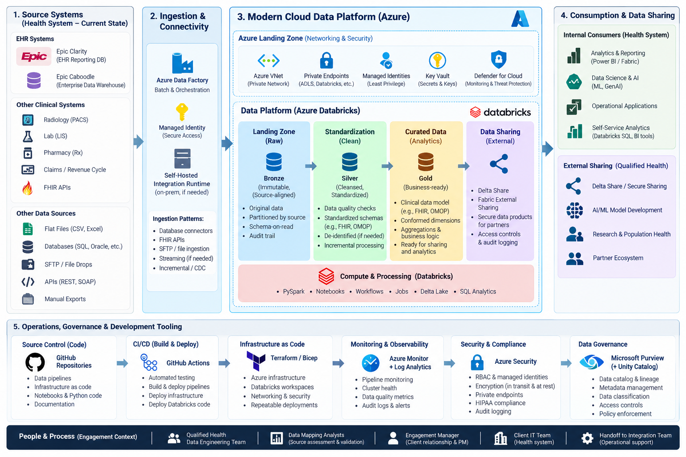

# Qualified Health — Data Modernization Case Study Interview Prep

A GitHub-ready interview preparation repository for a **Director of Data Modernization** case study focused on healthcare, Azure Databricks, ADLS Gen2, Data Factory, Terraform, GitHub Actions, Epic/FHIR, secure data sharing, and AI/ML.

> **Goal:** help a candidate explain not only *what technology to use*, but *how to assess a hospital environment, make architectural tradeoffs, lead delivery, secure PHI, modernize incrementally, and enable analytics/AI*.

## Architecture at a glance

## Recommended study order

1. [Case Study Strategy](docs/01_case_study_strategy.md)
2. [Architecture Walkthrough](docs/02_architecture_walkthrough.md)
3. [Azure + Databricks Deep Dive](docs/03_azure_databricks_deep_dive.md)
4. [Healthcare / Epic / FHIR Primer](docs/04_healthcare_data_ehr_fhir.md)
5. [Security, HIPAA & Governance](docs/05_security_hipaa_governance.md)
6. [AI/ML + GenAI Strategy](docs/06_ai_ml_genai_strategy.md)
7. [Leadership & Client-Facing Questions](docs/07_leadership_client_questions.md)
8. [60-Minute Mock Interview](docs/08_mock_interview_60min.md)
9. [Whiteboard Cheat Sheet](docs/09_whiteboard_cheatsheet.md)
10. [3-Day Preparation Plan](docs/10_three_day_plan.md)
11. [AI/ML Interview Question Bank](docs/11_ai_ml_interview_questions.md)
12. [Handoff / Go-Live Checklist](docs/12_handoff_checklist.md)

## Practical demos

- [`notebooks/01_medallion_pipeline_demo.py`](notebooks/01_medallion_pipeline_demo.py) — Bronze → Silver → Gold example
- [`notebooks/02_feature_engineering_ml_demo.py`](notebooks/02_feature_engineering_ml_demo.py) — healthcare ML feature engineering + MLflow pattern
- [`notebooks/03_ml_inference_monitoring_demo.py`](notebooks/03_ml_inference_monitoring_demo.py) — batch scoring + drift/quality checks
- [`terraform/README.md`](terraform/README.md) — IaC discussion guide
- [`.github/workflows/ci.yml`](.github/workflows/ci.yml) — simple interview-demo CI pattern

## 30-second role summary

This role is best thought of as:

**Technical Architect + Data Engineering Leader + Client-Facing Consultant + Hands-On Builder**

The candidate should repeatedly demonstrate this decision pattern:

**Discover → Assess → Design → Secure → Build → Validate → Operate → Handoff**

## The one sentence to remember

> “I would first understand the hospital’s source systems, data volumes, PHI constraints, latency requirements, downstream consumers, and operational pain points; then I would design the simplest secure, observable, recoverable cloud architecture that can be delivered in the engagement window without creating avoidable technical debt.”

## Disclaimer

This repository is for interview preparation and architecture discussion. It is not a legal or compliance certification guide. HIPAA compliance depends on the full technical, administrative, contractual, and operational control environment.
